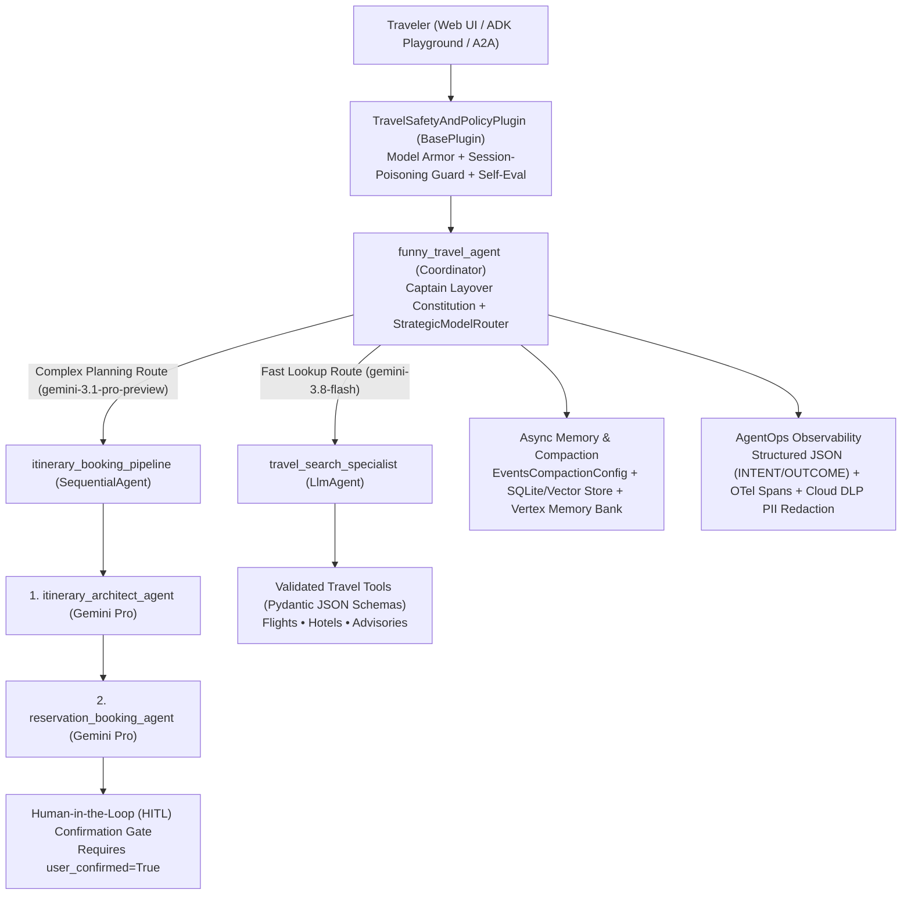

# Captain Layover — AI Travel Concierge (`funny-travel-agent`)

**Captain Layover** is a helpful, witty, multi-agent travel concierge built with the **Google Agent Development Kit (ADK)** in Python. It combines grounded flight and hotel discovery, destination safety/etiquette retrieval, itemized trip budget calculation, multi-day itinerary synthesis, and **Human-in-the-Loop (HITL)** reservation booking with enterprise-grade **AgentOps** (OpenTelemetry tracing, structured JSON Intent/Outcome logging, Cloud DLP + regex PII redaction, Google Cloud Secret Manager, ADK context compaction, and Terraform CI/CD).

---


## 🏗️ Multi-Agent Architecture



---

## 🌐 Web Interface & Local Quickstart

### 1. Install Dependencies
```bash
uv sync --all-groups --all-extras
```

### 2. Launch the Interactive Travel Agency Web UI
Start the FastAPI web server:
```bash
uv run uvicorn app.fast_api_app:app --host 0.0.0.0 --port 8000
```
- **Captain Layover Custom Web UI**: `http://localhost:8000/` (or `http://localhost:8000/travel-ui`)
  - Includes one-click demo buttons for Flight/Hotel Search, 3-Day Pro Itinerary + RAG Advisory, HITL Booking Confirmation Gate, and Guided Error Recovery, plus a live **AgentOps Telemetry Drawer** showing real-time `INTENT` vs. `OUTCOME` logs, OpenTelemetry trace/span IDs, and PII scrubbing.
- **ADK Built-in Developer Playground**: `http://localhost:8000/dev-ui/` (or run `agents-cli playground`)
- **Explicit Tool JSON Schemas Endpoint**: `http://localhost:8000/api/travel/schemas`

### 3. CLI Smoke Test (`agents-cli`)
```bash
agents-cli run "Find me flights from SFO to Tokyo (NRT) on 2026-11-15 for 2 passengers in economy and tell me a travel joke!"
```

---

## 🧪 Evaluation & Testing

### Run Golden Dataset Evaluation (`agents-cli eval`)
```bash
agents-cli eval run
```

### Run Unit & Integration Tests (`pytest`)
```bash
uv run pytest tests/unit -v
uv run pytest tests/integration -v
```

---

## ☁️ Infrastructure as Code (Terraform) & Deployment

Terraform configurations live in [`deployment/terraform/single-project/`](deployment/terraform/single-project/) and [`infra/terraform/`](infra/terraform/), with GitHub Actions CI/CD pipelines in [`.github/workflows/`](.github/workflows/).

```bash
# Provision single-project GCP infrastructure (Cloud Run, IAM, Secret Manager, Telemetry)
agents-cli infra single-project

# Deploy to Cloud Run
agents-cli deploy
```
