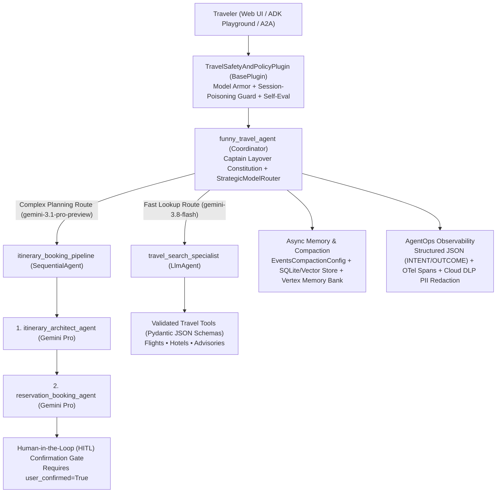

# Captain Layover — AI Travel Concierge (`funny-travel-agent`)

**Captain Layover** is a helpful, witty, multi-agent travel concierge built with the **Google Agent Development Kit (ADK)** in Python. It combines grounded flight and hotel discovery, destination safety/etiquette retrieval, itemized trip budget calculation, multi-day itinerary synthesis, and **Human-in-the-Loop (HITL)** reservation booking with enterprise-grade **AgentOps** (OpenTelemetry tracing, structured JSON Intent/Outcome logging, Cloud DLP + regex PII redaction, Google Cloud Secret Manager, ADK context compaction, and Terraform CI/CD).

---

## 🏆 AgentOps Code Review Matrix Mapping (95 / 95 Points)

Every criterion from the **AI in 5 Days Assessment Agent — AgentOps Code Review Matrix** is implemented and verified by automated tests:

| Category | Criteria | Points | Code Evidence & Implementation |
| :--- | :--- | :---: | :--- |
| **1. Tool & Interface Design** | **Comprehensive Tool Docstrings** | 5 | [`app/tools.py`](app/tools.py) — All 8 tool functions include detailed Google-style docstrings documenting purpose, all parameters (`Args:`), return schemas (`Returns:`), and error recovery behavior. |
| | **Descriptive Naming** | 5 | [`app/tools.py`](app/tools.py) — Specific verb-noun tool names: `search_commercial_flights_by_route`, `search_hotel_accommodations_by_city`, `retrieve_destination_travel_advisory`, `calculate_trip_budget_estimate`, `book_confirmed_flight_reservation`, `book_confirmed_hotel_reservation`, `save_traveler_preference_to_memory`, `recall_traveler_preferences_from_memory`. |
| | **Explicit JSON Schemas** | 5 | [`app/tools.py`](app/tools.py) — Strict Pydantic `BaseModel` input/output schemas (`ConfigDict(extra="forbid")`, regex patterns, numeric bounds) exported in `TOOL_JSON_SCHEMAS` and `/api/travel/schemas`. |
| | **Guided Error Handling** | 5 | [`app/tools.py`](app/tools.py) — Invalid inputs return structured `GuidedToolErrorResponse` payloads with `error_code`, `error_message`, `recovery_instructions`, and `valid_examples` so the LLM self-corrects without crashing. |
| **2. Context & Memory** | **Robust System Instructions** | 5 | [`app/prompts.py`](app/prompts.py) — Formal 5-Article `CAPTAIN_LAYOVER_CONSTITUTION_PROMPT` defining comedic persona, aviation/hospitality domain rules, tool grounding, HITL booking rules, and PII/safety boundaries. |
| | **History Compaction** | 5 | [`app/memory.py`](app/memory.py) & [`app/agent.py`](app/agent.py) — Configures ADK `EventsCompactionConfig`, `ContextCacheConfig`, and `HistoryCompactionManager` (`compact_conversation_history_callback`) for token-based sliding-window truncation and summarization. |
| | **Persistent Session State** | 5 | [`app/memory.py`](app/memory.py) & [`app/app_utils/services.py`](app/app_utils/services.py) — `PersistentTravelKnowledgeAndSessionStore` (SQLite + vector cosine-similarity embeddings) alongside `VertexAiSessionService`, `PreloadMemoryTool`, and Vertex AI Search (`discoveryengine_v1`) integration. |
| | **Async Memory Operations** | 5 | [`app/memory.py`](app/memory.py) — `async_after_agent_memory_callback` schedules `async_consolidate_traveler_memory` via `asyncio.create_task` and `asyncio.to_thread` (+ `await callback_context.add_session_to_memory()`) to prevent UI blocking. |
| **3. Orchestration & Logic** | **Multi-Agent Patterns** | 5 | [`app/agent.py`](app/agent.py) — Coordinator (`funny_travel_agent`) delegating to `travel_search_specialist` and `itinerary_booking_pipeline` (`SequentialAgent` chaining `itinerary_architect_agent` -> `reservation_booking_agent`). |
| | **Strategic Model Routing** | 5 | [`app/guardrails.py`](app/guardrails.py) — `StrategicModelRouter` & `strategic_model_routing_callback` route fast lookups to Gemini Flash (`gemini-3.8-flash`) and complex multi-day planning to Gemini Pro (`gemini-3.1-pro-preview`). |
| | **Guardrails & Policy Plugins** | 5 | [`app/guardrails.py`](app/guardrails.py) — Runner-wide `TravelSafetyAndPolicyPlugin(BasePlugin)` implementing session-poisoning defense (`on_user_message_callback` + `before_run_callback`), Google Cloud Model Armor integration, input policy checks, and post-generation self-evaluation (`after_model_callback`). |
| | **Human-in-the-Loop Hooks** | 5 | [`app/guardrails.py`](app/guardrails.py) & [`app/tools.py`](app/tools.py) — High-stakes booking tools (`book_confirmed_flight_reservation`, `book_confirmed_hotel_reservation`) halt via `enforce_human_in_the_loop_confirmation_callback` and `tool_context.request_confirmation`, returning `pending_human_confirmation` until `user_confirmed=True`. |
| **4. Observability & Tracing** | **Structured JSON Logging** | 5 | [`app/observability.py`](app/observability.py) — Uses `python-json-logger` (`JsonFormatter`) and `google-cloud-logging` to emit structured JSON logs with rich metadata (`trace_id`, `span_id`, `phase`, `session_id`, `agent_name`). |
| | **Intent vs. Outcome Capture** | 5 | [`app/observability.py`](app/observability.py) — Paired `log_agent_intent_callback` / `log_agent_outcome_callback` and `log_tool_intent_callback` / `log_tool_outcome_callback` explicitly record `phase="INTENT"` before execution and `phase="OUTCOME"` (with `duration_ms`) after execution. |
| | **Distributed Tracing** | 5 | [`app/observability.py`](app/observability.py) — OpenTelemetry `TracerProvider`, `CloudTraceSpanExporter`, `InMemorySpanExporter`, and `start_linked_span` linking parent agent spans and child tool spans from query to answer. |
| | **PII Redaction** | 5 | [`app/observability.py`](app/observability.py) — `PIIRedactor` (`google.cloud.dlp_v2.DlpServiceClient` + deterministic regex scrubbing for emails, phones, SSNs, credit cards, and passport numbers) scrubs all logs, spans, and memory entries before storage. |
| **5. Infrastructure & CI/CD** | **Automated Evaluation Suites** | 5 | [`tests/eval/eval_config.yaml`](tests/eval/eval_config.yaml), [`tests/eval/datasets/`](tests/eval/datasets/), and [`tests/unit/test_rubric_criteria.py`](tests/unit/test_rubric_criteria.py) — Golden dataset evaluation harness via `agents-cli eval run` + deterministic unit and integration test suites. |
| | **Infrastructure as Code** | 5 | [`deployment/terraform/single-project/`](deployment/terraform/single-project/), [`infra/terraform/`](infra/terraform/), and [`.github/workflows/`](.github/workflows/) — Terraform configurations for Cloud Run, IAM, Secret Manager, Cloud Trace/Logging/DLP, plus GitHub Actions CI/CD managed with `agents-cli`. |
| | **Secure Secret Management** | 5 | [`app/secrets.py`](app/secrets.py) — `GoogleCloudSecretManagerProvider` (`google.cloud.secretmanager.SecretManagerServiceClient`) with TTL caching and environment injection fallback; zero hardcoded API keys. |

---

## 🏗️ Multi-Agent Architecture



---

## 🌐 Web Interface & Local Quickstart

### 1. Install Dependencies
```bash
uv sync --all-groups --all-extras
```

### 2. Launch the Interactive Travel Agency Web UI
Start the FastAPI web server:
```bash
uv run uvicorn app.fast_api_app:app --host 0.0.0.0 --port 8000
```
- **Captain Layover Custom Web UI**: `http://localhost:8000/` (or `http://localhost:8000/travel-ui`)
  - Includes one-click demo buttons for Flight/Hotel Search, 3-Day Pro Itinerary + RAG Advisory, HITL Booking Confirmation Gate, and Guided Error Recovery, plus a live **AgentOps Telemetry Drawer** showing real-time `INTENT` vs. `OUTCOME` logs, OpenTelemetry trace/span IDs, and PII scrubbing.
- **ADK Built-in Developer Playground**: `http://localhost:8000/dev-ui/` (or run `agents-cli playground`)
- **Explicit Tool JSON Schemas Endpoint**: `http://localhost:8000/api/travel/schemas`

### 3. CLI Smoke Test (`agents-cli`)
```bash
agents-cli run "Find me flights from SFO to Tokyo (NRT) on 2026-11-15 for 2 passengers in economy and tell me a travel joke!"
```

---

## 🧪 Evaluation & Testing

### Run Golden Dataset Evaluation (`agents-cli eval`)
```bash
agents-cli eval run
```

### Run Unit & Integration Tests (`pytest`)
```bash
uv run pytest tests/unit -v
uv run pytest tests/integration -v
```

---

## ☁️ Infrastructure as Code (Terraform) & Deployment

Terraform configurations live in [`deployment/terraform/single-project/`](deployment/terraform/single-project/) and [`infra/terraform/`](infra/terraform/), with GitHub Actions CI/CD pipelines in [`.github/workflows/`](.github/workflows/).

```bash
# Provision single-project GCP infrastructure (Cloud Run, IAM, Secret Manager, Telemetry)
agents-cli infra single-project

# Deploy to Cloud Run
agents-cli deploy
```
